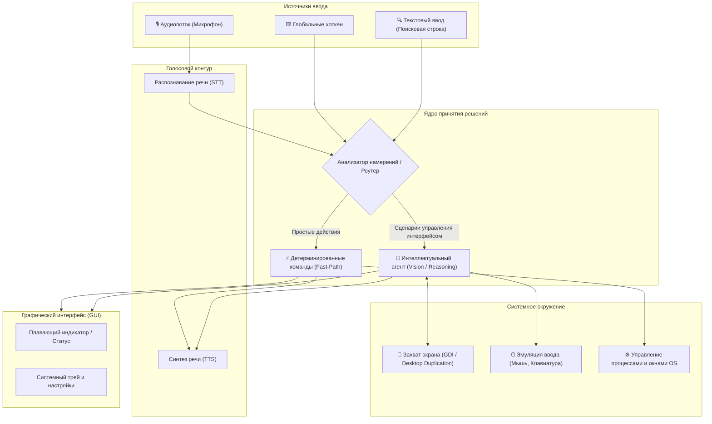

<div align="center">

# 🌌 LocalAgent

**Автономный локальный AI-ассистент операционной системы**

[](https://www.python.org/)
[](https://www.microsoft.com/windows)
[](https://github.com/Gupkagrop/localAgent)
[](https://github.com/Gupkagrop/localAgent)
[-orange.svg)](https://github.com/Gupkagrop/localAgent/tree/archive)

<p align="center">
  <b>Приватность • Локальный инференс • Голосовой интерфейс • Компьютерное зрение • Нативная автоматизация</b>
</p>

</div>

---

> [!NOTE]
> **Перезапуск архитектуры и подбор конфигурации:**  
> Проект находится на этапе проектирования модульного ядра и выбора оптимального технологического стека (моделей распознавания речи, синтеза, зрения и управления ресурсами).  
> Все наработки, скрипты и проверенные компоненты первой версии сохранены в ветке [`archive`](https://github.com/Gupkagrop/localAgent/tree/archive).

---

## 🎯 Концепция проекта

**LocalAgent** — это концепция персонального настольного ассистента, работающего автономно на машине пользователя. Ассистент объединяет голосовое управление, понимание происходящего на экране (Computer-Use) и прямое взаимодействие с операционной системой Windows.

### Ключевые принципы:

* 🔒 **Полная автономность и приватность:** Весь цикл обработки — от распознавания речи до анализа экрана и генерации действий — выполняется локально, без отправки пользовательских данных во внешние облачные сервисы.
* 🧩 **Модульность и заменяемость компонентов:** Архитектура строится по принципу независимых модулей с чёткими интерфейсами, что позволяет легко тестировать и менять используемые нейросети и движки инференса.
* ⚡ **Многоуровневая обработка команд:**
  * **Fast-Path:** Мгновенное выполнение детерминированных команд (запуск приложений, громкость, хоткеи, навигация) без обращения к тяжелым моделям.
  * **Cognitive/Vision Agent:** Подключение визуальных и языковых агентов для нестандартных или многошаговых задач на экране.
* 🖥️ **Нативная интеграция с ОС:** Низкоуровневый перехват горячих клавиш, быстрый захват кадров рабочего стола, безопасная эмуляция пользовательского ввода и ненавязчивый интерфейс.

---

## 🏗️ Общая архитектурная схема



---

## 🧭 Направления проработки (Roadmap)

- [x] **Этап 0:** Создание и тестирование прототипа v1.0 (зафиксирован в [`archive`](https://github.com/Gupkagrop/localAgent/tree/archive)).
- [ ] **Этап 1: Подбор конфигурации и бенчмаркинг:**
  - Оценка моделей распознавания речи (STT) по критериям точности, латентности и потребления ресурсов.
  - Подбор легковесного и качественного локального движка синтеза речи (TTS).
  - Выбор и тестирование компактных мультимодальных моделей (VLM) для анализа экрана и генерации координат кликов.
  - Формирование требований к аппаратному профилю (VRAM, CPU, RAM).
- [ ] **Этап 2: Проектирование модульного ядра:**
  - Изоляция инференса моделей в отдельных процессах для предотвращения взаимных блокировок и утечек памяти.
  - Разработка унифицированного межпроцессного протокола обмена событиями и командами.
- [ ] **Этап 3: Интерфейс и пользовательский опыт:**
  - Реализация минималистичного оверлея с визуализацией состояния и быстрой командной строкой.
  - Интеграция с системным треем и гибкая конфигурация через профили настроек.
- [ ] **Этап 4: Комплексное тестирование и оптимизация:**
  - Создание набора сквозных тестов, проверка отказоустойчивости и задержек отклика.

---

## 📂 Организация проекта

```text
localAgent/
├── .gitignore              # Исключения системных и временных файлов
├── README.md               # Описание архитектуры и концепции
├── config/                 # Профили конфигурации и настройки
├── core/                   # Базовые модули и интерфейсы
├── gui/                    # Компоненты графического интерфейса
└── tests/                  # Набор тестов и сценариев верификации
```

---

## 📜 Лицензия

Проект разрабатывается под лицензией **MIT**.
