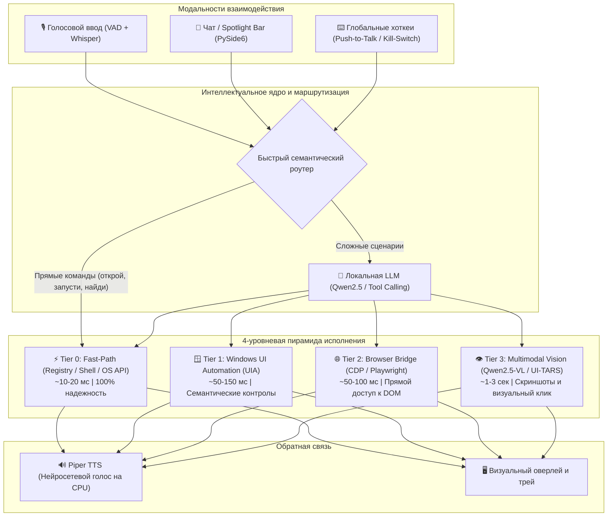

# 🌌 LocalAgent — Персональный автономный агент управления компьютером

> [!NOTE]
> **Назначение проекта:** 100% локальный, приватный ИИ-ассистент операционной системы Windows 11 с голосовым и чат-управлением. Агент способен запускать приложения, открывать веб-сайты, выполнять консольные команды и взаимодействовать с элементами интерфейса на экране без передачи данных в облако.

---

## 💡 Концепция и ключевая идея

Большинство существующих "Computer-Use" агентов используют ресурсоемкий и медленный подход «скриншот ➔ нейросеть ➔ клик по пикселям». Для простых задач (запуск Telegram, открытие YouTube или вызов терминала) такой подход тратит от 5 до 15 секунд и перегружает видеокарту.

**LocalAgent** решает эту проблему через **4-уровневую гибридную пирамиду автоматизации**:



---

## ⚡ Описание уровней исполнения (4-Tier Automation)

| Уровень | Технология | Примеры задач | Время реакции | Нагрузка VRAM |
| :--- | :--- | :--- | :--- | :--- |
| **Tier 0: Fast-Path** | Win32 API, Windows Registry, `.lnk` парсер, `os.startfile`, PowerShell | «Открой Telegram», «Запусти консоль», «Открой YouTube», «Сделай тише», «Сверни все окна» | **< 20 мс** | **0 МБ** |
| **Tier 1: Semantic UIA** | `uiautomation`, Microsoft UI Automation | Клик по кнопкам в стандартных программах (Блокнот, Проводник, Настройки), заполнение полей ввода | **~50–150 мс** | **0 МБ** |
| **Tier 2: Browser Bridge** | Chrome DevTools Protocol (CDP) / легкий Web Bridge | Клик по элементам веб-страниц, поиск видео, отправка форм без слепого поиска по пикселям | **~50–100 мс** | **0 МБ** |
| **Tier 3: Vision Fallback** | `mss` + Qwen2.5-VL-3B / UI-TARS (4-bit) | Сложные неразмеченные интерфейсы (игры, медиаплееры, канвас, нестандартные GUI) | **~1–2 сек** | **~3–4 ГБ** |

---

## 🎙️ Голосовой контур и работа на CPU

Чтобы видеокарта (8 ГБ VRAM) оставалась свободной для моделей рассуждения и зрения, весь голосовой контур спроектирован для мгновенной работы на **CPU**:

1. **Silero VAD (Voice Activity Detection):**
   * Мгновенно (< 5 мс) отличает речь от шума и пауз.
   * Потребляет менее 1% ресурсов CPU.
2. **Faster-Whisper (STT):**
   * Модель `small` / `base` с квантованием INT8 на CPU или с ультра-низким VRAM footprint (~300 МБ).
   * Высокая точность для русской и английской речи.
3. **Piper TTS (Синтез речи):**
   * Модель `ru_RU-dmitri-medium` / `ru_RU-ruslan-medium` (ONNX CPU).
   * Задержка синтеза менее 50 мс, естественное человеческое звучание, 0 МБ VRAM.

---

## 🖥️ Графический интерфейс: Spotlight & Chat

* **Плавающий Spotlight Bar (по аналогии с Raycast / PowerToys Run):**
  * Вызывается горячей клавишей (например, `Alt+Space` или `Win+Space`).
  * Единая строка: можно ввести текстовый запрос или говорить в микрофон.
  * Лаконичный дизайн в стиле Windows 11 Fluent Design / Acrylic.
* **Чат-панель истории и размышлений:**
  * Выдвижная панель, показывающая шаги выполнения, логи инструментов и ответы ассистента.
* **Системный трей и быстрые настройки:**
  * Фоновая работа, индикация статуса (Слушаю / Думаю / Выполняю / Ожидание).

---

## 🛡️ Безопасность и аварийный сброс (Emergency Kill-Switch)

* **Мгновенное прерывание (Kill-Switch):** При нажатии `Esc` или резком движении мыши ассистент немедленно останавливает эмуляцию ввода, сбрасывает очереди и отпускает зажатые клавиши.
* **Зона изоляции и подтверждения:** Опасные системные операции (удаление файлов, форматирование, завершение системных процессов) требуют явного подтверждения пользователя.
* **Изоляция процессов:** Аудио-поток, графический интерфейс и инференс моделей работают в независимых процессах для предотвращения взаимных зависаний (GIL) и конфликтов CUDA библиотек.

---

## 📁 Структура проекта

```text
localAgent/
├── .gitignore                  # Исключения бинарников, моделей, venv
├── .repomixignore              # Исключения для AST-сборки Repomix
├── AGENTS.md                   # Контракт и правила разработки для ИИ-агентов
├── TASK.md                     # Трекер состояния задач и архитектурных решений
├── README.md                   # Архитектурное описание проекта
├── config/                     # Настройки, алиасы приложений, горячие клавиши
├── core/
│   ├── app_finder.py           # Быстрый сканер приложений (Registry + Start Menu)
│   ├── os_controller.py        # Исполнитель команд ОС (Shell, Win32, Apps)
│   ├── uia_controller.py       # Семантический UI Automation контроллер
│   ├── voice/                  # Голосовой контур (VAD, STT, TTS)
│   └── routing/                # Маршрутизатор (Fast-Path + LLM Brain)
├── gui/                        # Графический интерфейс на PySide6
└── docs/                       # Детальная архитектурная документация
    └── architecture/
        ├── system_overview.md
        ├── fast_path_spec.md
        ├── voice_pipeline.md
        └── vision_and_routing.md
```
