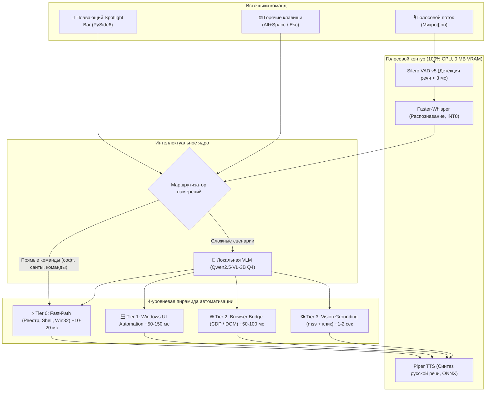
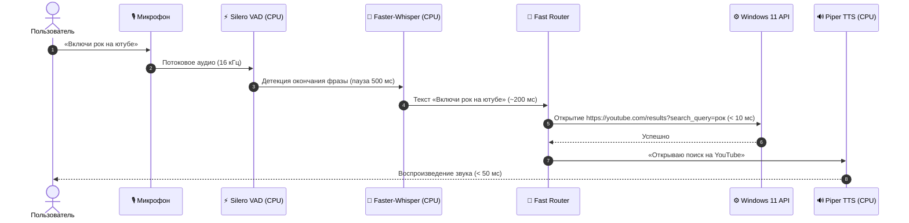

<div align="center">

# 🎖️ GupkaCommander

**Автономный локальный командный центр и оператор операционной системы Windows 11**

[](https://www.microsoft.com/windows)
[](https://www.python.org/)
[](https://doc.qt.io/qtforpython-6/)
[](#-аппаратный-профиль-и-бюджет-памяти)
[](#-принципы-проекта)
[](#-матрица-уровней-исполнения-4-tier-pyramid)
[](LICENSE)

<p align="center">
  <b>Приватность • 100% Офлайн-инференс • Голосовой контур на CPU • Сверхбыстрый Fast-Path • Экранное зрение (VLM)</b>
</p>

</div>

---

> [!NOTE]
> **GupkaCommander** — это персональный ИИ-оператор компьютера, работающий автономно на вашем ПК под управлением Windows 11.  
> Ассистент принимает команды голосом или через плавающий чат (Spotlight Bar), мгновенно запускает любые установленные приложения, открывает сайты и музыку в браузере, исполняет консольные команды и взаимодействует с интерфейсом через нативные системные API и локальную мультимодальную модель.

---

## ⚡ Почему GupkaCommander быстрее аналогов?

Большинство существующих систем «Computer-Use» действуют в лоб: делают скриншот рабочего стола, скармливают его тяжелой модели и пытаются кликнуть мышью по найденным пикселям. Для простых задач (открыть Telegram, запустить консоль, найти видео на YouTube) такой подход тратит от **5 до 15 секунд** и нагружает GPU.

В **GupkaCommander** применена **4-уровневая гибридная архитектура**:

1. **80% действий (запуск софта, ссылок, консоли, громкости) исполняются на Tier 0 (Fast-Path) за < 20 мс** через реестр Windows и системные протоколы с нулевым расходом VRAM.
2. **Семантические интерфейсы управляются на Tier 1 (UIA) за ~50–100 мс** через внутреннее дерево доступности Windows без движения физической мыши.
3. **Голосовой контур (VAD + Whisper + Piper) на 100% вынесен на CPU**, сохраняя все 8 ГБ видеопамяти под локальную модель.
4. **Визуальное зрение (Tier 3 VLM)** подключается только тогда, когда элемент невозможно достать через нативные API.

---

## 🏗️ Архитектура системы



---

## 🔄 Жизненный цикл голосовой команды



---

## 📊 Матрица уровней исполнения (4-Tier Pyramid)

| Уровень | Технологический стек | Сценарии использования | Задержка | Расход VRAM |
| :--- | :--- | :--- | :--- | :--- |
| **Tier 0: Fast-Path** | Windows Registry, `.lnk` парсер, `rapidfuzz`, Win32 API, `os.startfile` | Запуск Telegram, Chrome, терминала, переход на YouTube, регулировка звука | **< 20 мс** | **0 МБ** |
| **Tier 1: Semantic UIA** | `uiautomation` (Microsoft UI Automation COM) | Клик по кнопкам в Блокноте, Проводнике, окнах настроек, ввод текста по ID | **~50–150 мс** | **0 МБ** |
| **Tier 2: Browser Bridge** | Chrome DevTools Protocol (CDP) / Playwright | Заполнение веб-форм, поиск видео, клик по ссылкам на страницах | **~50–100 мс** | **0 МБ** |
| **Tier 3: Vision Fallback** | `mss` + `Qwen2.5-VL-3B-Instruct` (Q4_K_M) + `pyautogui` | Сложные неразмеченные интерфейсы, видеоплееры, игры, нестандартный GUI | **~1–2 сек** | **~2.6 ГБ** |

---

## 💻 Аппаратный профиль и бюджет памяти

Конфигурация оптимизирована для мобильных и настольных рабочих станций с ограниченным объемом видеопамяти:

* **Целевой GPU:** NVIDIA GeForce RTX 5050 Laptop (8 151 МБ VRAM)
* **Целевой CPU:** Intel Core i5-14450HX (10 ядер, 16 потоков)
* **Оперативная память:** 16 ГБ RAM

| Компонент | Вычислитель | Потребление памяти |
| :--- | :--- | :--- |
| **ОС Windows 11 + дисплеи** | GPU / RAM | ~800–1 000 МБ VRAM / ~6–7 ГБ RAM |
| **Silero VAD + Faster-Whisper + Piper TTS** | CPU | **0 МБ VRAM** / ~350 МБ RAM |
| **Qwen2.5-VL-3B-Instruct (Q4_K_M GGUF)** | GPU | **~2 500–2 800 МБ VRAM** / ~200 МБ RAM |
| **PySide6 GUI + Fast-Path кэш** | CPU / DWM | **0 МБ VRAM** / ~90 МБ RAM |
| **Резерв видеопамяти под буферы** | GPU | **> 4 000 МБ VRAM (Свободно)** |

---

## 🛡️ Безопасность и аварийный сброс (Emergency Kill-Switch)

> [!IMPORTANT]
> Безопасность операционной системы — главный приоритет GupkaCommander:
> * **Аппаратный перехватчик `Esc`:** Нажатие клавиши `Esc` в любую миллисекунду мгновенно обрывает цикл эмуляции мыши и клавиатуры, очищает очереди действий и возвращает контроль человеку.
> * **Mouse Shake Detector:** Резкое физическое перемещение мыши пользователем (> 350 px за 100 мс) расценивается как перехват управления и отключает автономный ввод.
> * **Подтверждение опасных действий:** Команды форматирования, удаления системных файлов или завершения критических процессов Windows блокируются до подтверждения в окне диалога.

---

## 📁 Организация репозитория

```text
GupkaCommander/
├── .gitignore                      # Исключения системных и временных файлов
├── .repomixignore                  # Правила упаковки AST-сборки Repomix
├── AGENTS.md                       # Контракт разработки и правила для ИИ-агентов
├── TASK.md                         # Журнал состояния и сквозной памяти (SOP)
├── README.md                       # Презентация и архитектура проекта
├── pyproject.toml                  # Конфигурация uv, ruff, mypy, pytest
├── .env.example                    # Документация переменных окружения
├── config/
│   ├── settings.json               # Параметры моделей, хоткеев и звука
│   └── commands.json               # Базовые алиасы программ и сайтов
├── docs/                           # Инженерная документация
│   └── architecture/
│       ├── system_overview.md      # Обзор архитектуры ядра и IPC
│       ├── ideal_stack_analysis.md # Исследование и обоснование стека
│       ├── fast_path_spec.md       # Спецификация детерминированного запуска
│       ├── voice_pipeline.md       # Спецификация голосового контура (CPU)
│       └── vision_and_routing.md   # Спецификация роутера и экранного зрения
├── core/                           # Модули автоматизации ОС
│   └── .gitkeep
├── gui/                            # Компоненты интерфейса (PySide6)
│   └── .gitkeep
└── tests/                          # Набор тестов и сценариев верификации
    └── .gitkeep
```

---

## 🗺️ Дорожная карта (Roadmap)

- [x] **Фаза 1: Архитектурное исследование и спецификации**
  - [x] Анализ подходов к локальным агентам (UI-TARS, Qwen2.5-VL, Fast-Path)
  - [x] Формирование идеального технологического стека под 8GB VRAM
  - [x] Ребрендинг в GupkaCommander и эталонное оформление репозитория
- [ ] **Фаза 2: Скелет ядра и Fast-Path автоматизация**
  - [ ] Быстрый сканер софта (Registry + `.lnk` + `rapidfuzz`)
  - [ ] Запуск браузера, веб-ссылок и поисковых запросов
  - [ ] Модуль работы с терминалом и консолью Windows
  - [ ] Модуль управления окнами (Win32) и системным звуком
- [ ] **Фаза 3: Графический интерфейс и голосовой контур**
  - [ ] Плавающий Spotlight Bar на PySide6 (Windows 11 Mica/Acrylic)
  - [ ] Потоковый VAD + Faster-Whisper + Piper TTS на CPU
  - [ ] Интеграция Barge-In и системного трея
- [ ] **Фаза 4: Интеллектуальный роутер и Vision Grounding**
  - [ ] Подключение локального инференса Qwen2.5-VL через llama-server
  - [ ] Двухуровневый роутер (детерминированный Fast-Path vs Tool Calling)
  - [ ] Семантическая автоматизация (UIA) и визуальный клик (mss)

---

## 📜 Лицензия

Проект распространяется под открытой лицензией **MIT**. Разработано [Gupkagrop](https://github.com/Gupkagrop).
