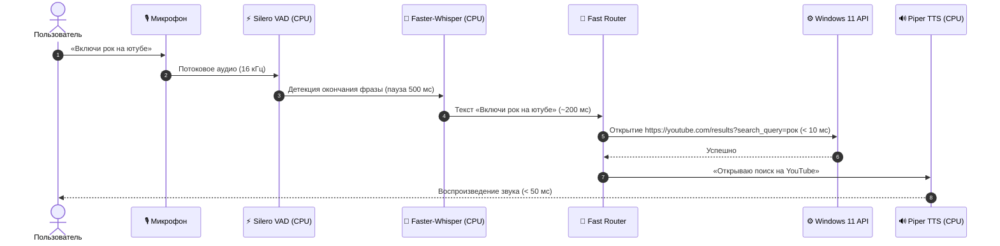

<div align="center">

# 🎖️ GupkaCommander

**Автономный локальный командный центр и оператор операционной системы Windows 11**

[](https://www.microsoft.com/windows)
[](https://www.python.org/)
[](https://doc.qt.io/qtforpython-6/)
[](#-тестирование-и-сенсоры-качества)
[](https://github.com/astral-sh/ruff)
[](https://mypy-lang.org/)
[](#-аппаратный-профиль-и-бюджет-памяти)
[](#-принципы-проекта)
[](#-матрица-уровней-исполнения-4-tier-pyramid)
[-blueviolet.svg)](#-автономная-дистрибуция-и-инсталлятор-вектор-4)

<p align="center">
  <b>Приватность • 100% Офлайн-инференс • Голосовой контур на CPU • Сверхбыстрый Fast-Path • Экранное зрение (VLM)</b>
</p>

</div>

---

> [!NOTE]
> **GupkaCommander** — это персональный ИИ-оператор компьютера, работающий автономно на вашем ПК под управлением Windows 11.  
> Ассистент принимает команды голосом или через плавающий чат (Spotlight Bar), мгновенно запускает любые установленные приложения, открывает сайты и музыку в браузере, исполняет консольные команды и взаимодействует с интерфейсом через нативные системные API и локальную мультимодальную модель.

---

## ⚡ Почему GupkaCommander быстрее аналогов?

Большинство существующих систем «Computer-Use» действуют в лоб: делают скриншот рабочего стола, скармливают его тяжелой модели и пытаются кликнуть мышью по найденным пикселям. Для простых задач (открыть Telegram, запустить консоль, найти видео на YouTube) такой подход тратит от **5 до 15 секунд** и нагружает GPU.

В **GupkaCommander** применена **4-уровневая гибридная архитектура**:

1. **80% действий (запуск софта, ссылок, консоли, громкости) исполняются на Tier 0 (Fast-Path) за < 20 мс** через реестр Windows и системные протоколы с нулевым расходом VRAM.
2. **Семантические интерфейсы управляются на Tier 1 (UIA) за ~50–100 мс** через внутреннее дерево доступности Windows без движения физической мыши.
3. **Голосовой контур (VAD + Whisper + Piper) на 100% вынесен на CPU**, сохраняя все 8 ГБ видеопамяти под локальную модель.
4. **Визуальное зрение (Tier 3 VLM)** подключается только тогда, когда элемент невозможно достать через нативные API.

---

## 🏗️ Архитектура системы


---

## ⚡ Быстрый старт и запуск в 1 клик

Для запуска GupkaCommander на Windows 11 предусмотрены готовые скрипты в корне проекта:

### Вариант 1: Запуск через Проводник (Рекомендуется)
* **`start.bat`** — просто дважды кликните по файлу в папке проекта. Скрипт проверит окружение, при необходимости предложит скачать легковесные речевые модели и запустит приложение.
* **`setup.bat`** — скрипт полной первоначальной настройки под ключ: синхронизирует зависимости, сгенерирует фирменную иконку, загрузит речевые модели и создаст ярлык **GupkaCommander** на вашем Рабочем столе.
* **`start_quiet.vbs`** — запуск приложения в скрытом фоновом режиме (без всплывающего черного консольного окна, приложение сразу доступно в трее по **`Alt+Space`**).

### Вариант 2: Запуск из терминала PowerShell
```powershell
# Запуск приложения
.\start.ps1

# Запуск в фоновом режиме (тихий запуск в системный трей)
.\start.ps1 -Background

# Первоначальная настройка
.\start.ps1 -Setup
```

### Вариант 3: Запуск через `uv`
```powershell
uv run python main.py
```

### Вариант 4: Автономный запуск без Python (.exe)
GupkaCommander может работать полностью автономно без установленного Python и `uv`:
* **Сборка автономного пакета в 1 клик:** запустите `build.bat` — скрипт скомпилирует `dist/GupkaCommander/GupkaCommander.exe` (70.48 MB, общий пакет 898 MB) со всеми библиотеками PySide6, CTranslate2, ONNXRuntime и 385 таблицами русской фонетики `espeak-ng-data`.
* **Автономный запуск:** запустите `dist/GupkaCommander/GupkaCommander.exe` (или ярлык на Рабочем столе).
* **Сборка инсталлятора Inno Setup:** запустите `uv run python scripts/build_installer.py` для создания единого мастера установки `Setup.exe`.

> [!TIP]
> * **Горячая клавиша:** Нажмите **`Alt+Space`** в любом месте Windows, чтобы открыть строку ввода.
> * **Аварийный сброс:** Нажмите **`Esc`** или покачайте мышь для мгновенной остановки действий (Fail-Safe).

---

## 🔄 Жизненный цикл голосовой команды



---

## 📊 Матрица уровней исполнения (4-Tier Pyramid)

| Уровень | Технологический стек | Сценарии использования | Задержка | Расход VRAM |
| :--- | :--- | :--- | :--- | :--- |
| **Tier 0: Fast-Path** | Windows Registry, `.lnk` парсер, `rapidfuzz`, Win32 API, `os.startfile` | Запуск Telegram, Chrome, терминала, переход на YouTube, регулировка звука | **< 20 мс** | **0 МБ** |
| **Tier 1: Semantic UIA** | `uiautomation` (Microsoft UI Automation COM) | Клик по кнопкам в Блокноте, Проводнике, окнах настроек, ввод текста по ID | **~50–150 мс** | **0 МБ** |
| **Tier 2: Browser Bridge** | Chrome DevTools Protocol (CDP) / Playwright | Заполнение веб-форм, поиск видео, клик по ссылкам на страницах | **~50–100 мс** | **0 МБ** |
| **Tier 3: Vision Fallback** | `mss` + `Qwen3-VL-4B-Instruct` (Q4_K_M + mmproj Q8_0) + `pyautogui` | Сложные неразмеченные интерфейсы, видеоплееры, игры, нестандартный GUI | **~1–2 сек** | **~3.4 ГБ** |

---

## 💻 Аппаратный профиль и бюджет памяти

Конфигурация оптимизирована для мобильных и настольных рабочих станций с ограниченным объемом видеопамяти:

* **Целевой GPU:** NVIDIA GeForce RTX 5050 Laptop (8 151 МБ VRAM)
* **Целевой CPU:** Intel Core i5-14450HX (10 ядер, 16 потоков)
* **Оперативная память:** 16 ГБ RAM

| Компонент | Вычислитель | Потребление памяти |
| :--- | :--- | :--- |
| **ОС Windows 11 + дисплеи** | GPU / RAM | ~800–1 000 МБ VRAM / ~6–7 ГБ RAM |
| **Silero VAD + Faster-Whisper + Piper TTS** | CPU | **0 МБ VRAM** / ~350 МБ RAM |
| **Qwen3-VL-4B-Instruct (Q4_K_M + mmproj Q8_0)** | GPU | **~3 400–4 000 МБ VRAM** / ~250 МБ RAM |
| **PySide6 GUI + Fast-Path кэш** | CPU / DWM | **0 МБ VRAM** / ~90 МБ RAM |
| **Резерв видеопамяти под буферы** | GPU | **> 4 000 МБ VRAM (Свободно)** |

---

## 🛡️ Безопасность и аварийный сброс (Emergency Kill-Switch)

> [!IMPORTANT]
> Безопасность операционной системы — главный приоритет GupkaCommander:
> * **Аппаратный перехватчик `Esc`:** Нажатие клавиши `Esc` в любую миллисекунду мгновенно обрывает цикл эмуляции мыши и клавиатуры, очищает очереди действий и возвращает контроль человеку.
> * **Mouse Shake Detector:** Резкое физическое перемещение мыши пользователем (> 350 px за 100 мс) расценивается как перехват управления и отключает автономный ввод.
> * **Подтверждение опасных действий:** Команды форматирования, удаления системных файлов или завершения критических процессов Windows блокируются до подтверждения в окне диалога.

---

## 📁 Организация репозитория

```text
GupkaCommander/
├── start.bat                       # 🚀 Запуск приложения в 1 клик
├── setup.bat                       # 🛠️ Мастер первоначальной настройки под ключ
├── build.bat                       # 📦 Сборка автономного .exe и инсталлятора
├── start_quiet.vbs                 # 🤫 Бесшумный запуск в трей (без консольного окна)
├── start.ps1                       # 💻 PowerShell скрипт запуска (-Background, -Setup)
├── GupkaCommander.spec             # ⚙️ PyInstaller спецификация автономной сборки
├── .gitignore                      # Исключения системных и временных файлов
├── .repomixignore                  # Правила упаковки AST-сборки Repomix
├── AGENTS.md                       # Контракт разработки и правила для ИИ-агентов
├── TASK.md                         # Журнал состояния и сквозной памяти (SOP)
├── README.md                       # Презентация и архитектура проекта
├── pyproject.toml                  # Конфигурация uv, ruff, mypy, pytest
├── .env.example                    # Документация переменных окружения
├── assets/                         # Фирменные иконки (Fluent Dark .ico / .png)
├── scripts/                        # Скрипты загрузки моделей, сборки и llama-server
│   ├── download_models.py          # Загрузчик весов VAD, Piper, Whisper, VLM
│   ├── generate_icon.py            # Генератор многослойной иконки Windows
│   ├── create_shortcut.py          # Создание ярлыков на Рабочем столе и в автозагрузке
│   ├── run_llama_server.bat        # Запуск GPU сервера инференса под RTX 5050
│   ├── build_executable.py         # Автоматическая сборка автономного .exe (PyInstaller)
│   ├── build_installer.py          # Компиляция Inno Setup инсталлятора (Setup.exe)
│   └── installer.iss               # Спецификация инсталлятора Windows (user/admin)
├── config/
│   ├── settings.json               # Параметры моделей, хоткеев и звука
│   ├── commands.json               # Базовые алиасы программ и сайтов
│   └── memory.db                   # Долговременная память SQLite WAL (FTS5)
├── docs/                           # Инженерная документация
│   └── architecture/
│       ├── system_overview.md      # Обзор архитектуры ядра и IPC
│       ├── ideal_stack_analysis.md # Исследование и обоснование стека
│       ├── fast_path_spec.md       # Спецификация детерминированного запуска
│       ├── voice_pipeline.md       # Спецификация голосового контура (CPU)
│       └── vision_and_routing.md   # Спецификация роутера и экранного зрения
├── core/                           # Модули автоматизации ОС
│   ├── paths.py                    # Виртуализация путей (_MEIPASS vs %LOCALAPPDATA%)
│   ├── app_finder.py               # Сканер приложений и .lnk (rapidfuzz)
│   ├── os_controller.py            # Управление URL, шеллом, окнами и звуком
│   ├── failsafe.py                 # Аварийный монитор (Esc / Mouse Shake)
│   ├── brain/                      # Когнитивное планирование (LocalLLMClient SSE)
│   ├── routing/                    # Двухуровневый Fast-Path First роутер
│   ├── uia/                        # Microsoft UI Automation (Tier 1 UIA контроллер)
│   ├── memory/                     # Долговременная память SQLite WAL и FTS5 заметки
│   ├── vision/                     # Экранный захват (mss + DPI) и координатный клик
│   └── voice/                      # Речевой контур (VAD, Whisper, Piper, Streaming)
├── gui/                            # Компоненты интерфейса (PySide6 Fluent Dark)
│   ├── spotlight_bar.py            # Плавающая поисковая строка
│   ├── waveform_widget.py          # Анимированный эквалайзер речевой активности
│   ├── chat_drawer.py              # Выдвижная история сообщений и живая печать
│   ├── hotkey_manager.py           # Win32 глобальный хоткей Alt+Space
│   └── tray_icon.py                # Системный трей Windows
└── tests/                          # 570 тестов детерминированной верификации
```

---

## 🗺️ Дорожная карта (Roadmap)

- [x] **Фаза 1: Архитектурное исследование и спецификации**
  - [x] Анализ подходов к локальным агентам (UI-TARS, Qwen2.5-VL, Fast-Path)
  - [x] Формирование идеального технологического стека под 8GB VRAM
  - [x] Ребрендинг в GupkaCommander и эталонное оформление репозитория
- [x] **Фаза 2: Скелет ядра и Fast-Path автоматизация**
  - [x] Быстрый сканер софта (Registry + `.lnk` + `rapidfuzz`)
  - [x] Запуск браузера, веб-ссылок и поисковых запросов
  - [x] Модуль работы с терминалом и консолью Windows с усиленной защитой
  - [x] Модуль управления окнами (Win32) и системным звуком
- [x] **Фаза 3: Графический интерфейс и голосовой контур**
  - [x] Потоковый VAD + Faster-Whisper + Piper TTS на CPU (Спринт 2)
  - [x] Интеграция механизма немедленного перебивания (Barge-In)
  - [x] Плавающий Spotlight Bar на PySide6 (Windows 11 Fluent Dark) (Спринт 3)
  - [x] Интеграция системного трея и глобального хоткея Alt+Space (Спринт 3)
- [x] **Фаза 4: Интеллектуальный роутер и Vision Grounding**
  - [x] Подключение локального инференса Qwen2.5-VL через llama-server (OpenAI API)
  - [x] Двухуровневый роутер (детерминированный Fast-Path vs Tool Calling)
  - [x] Семантическая автоматизация и визуальный клик (mss + DPI awareness)
- [x] **Фаза 5: Развертывание и Векторы Развития**
  - [x] **Вектор 1 (Tier 1 UIA):** Нативное управление элементами Windows без движения мыши
  - [x] **Вектор 2 (Streaming TTS):** Параллельный потоковый синтез с задержкой звука < 300 мс
  - [x] **Вектор 3 (Episodic Memory):** Долговременная память SQLite WAL, факты и FTS5-заметки
  - [x] **Вектор 4 (Distribution):** Автономный пакет PyInstaller (898 MB) и инсталлятор Inno Setup
- [x] **Фаза 6: Полировка и Финальный Аудит (Dual-Model Gate)**
  - [x] Независимый аудит **Claude Sonnet 5.5** (9.5/10) и **Gemini 4 Argon** (9.8/10)
  - [x] Устранение векторов обхода (EncodedCommand, regex format, ctypes x64)
  - [x] Все 570 тестов зеленые, 0 предупреждений ruff, 0 ошибок mypy strict

---

## 🧪 Тестирование и сенсоры качества (Harness)

Проект полностью защищен детерминированными сенсорами качества:

```powershell
# Запуск полного набора тестов (588 тестов)
uv run pytest -q

# Статический анализ кода (Ruff linter)
uv run ruff check .

# Проверка форматирования (Ruff formatter)
uv run ruff format --check .

# Строгая проверка типов (Mypy strict, 74 файла)
uv run mypy core gui tests scripts main.py
```

---

## 📜 Лицензия

Проект распространяется под открытой лицензией **MIT**. Разработано [Gupkagrop](https://github.com/Gupkagrop).
