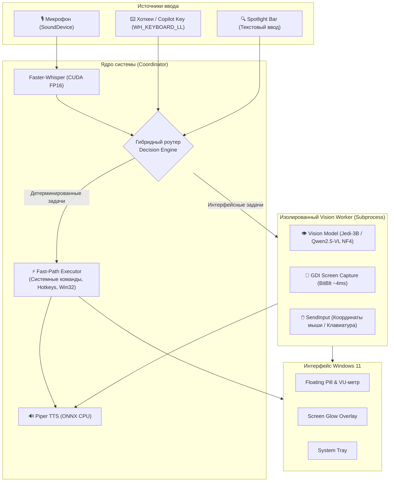

<div align="center">

# 🌌 LocalAgent (Antigravity Jarvis)

**Автономный локальный голосовой и мультимодальный AI-ассистент для Windows 11**

[](https://www.python.org/)
[](https://www.microsoft.com/windows)
[](https://developer.nvidia.com/cuda-toolkit)
[](#архитектурные-принципы)
[-success.svg)](https://github.com/Gupkagrop/localAgent)
[](https://github.com/Gupkagrop/localAgent/tree/archive)

<p align="center">
  <b>100% приватный • Без облачных подписок • Автономное компьютерное зрение • Мгновенный отклик</b>
</p>

</div>

---

> [!NOTE]
> **Перезапуск архитектуры:** Исходная версия v1.0 со всеми наработками, тестами и прототипом управления экраном бережно сохранена в ветке [`archive`](https://github.com/Gupkagrop/localAgent/tree/archive).  
> В ветке `main` разворачивается разработка следующего поколения с обновленным модульным ядром, повышенной производительностью и строгой изоляцией процессов.

---

## 🎯 Концепция проекта

**LocalAgent** — это персональный локальный агент-ассистент операционной системы, объединяющий голосовой интерфейс реального времени и компьютерное зрение для автоматизации повседневных задач на ПК без выхода в интернет.

### Ключевые возможности:

* 🔒 **100% локальная приватность:** Звук с микрофона, скриншоты экрана и системные команды никогда не покидают ваш компьютер.
* ⚡ **Гибридный Fast-Path роутер:** Детерминированные команды (запуск программ, системная громкость, быстрый поиск) исполняются мгновенно (<10 мс) без задействования тяжёлых нейросетей.
* 🎙️ **Быстрый голосовой контур:** Аппаратное распознавание речи на GPU (Faster-Whisper CUDA FP16) + естественный синтез речи без задержек (Piper Neural TTS на CPU).
* 👁️ **Computer-Use Vision Agent:** Компактная Vision-Language модель для понимания интерфейса и взаимодействия с элементами экрана кликами и клавиатурой (Win32 GDI BitBlt + SendInput).
* 🎨 **Fluent GUI для Windows 11:** Компактный плавающий статус-оверлей (Floating Pill), поиск Spotlight, системный трей и мягкая контурная индикация активности (Screen Glow).

---

## 🏗️ Архитектурные принципы



---

## 🛠️ Стек технологий

| Компонент | Технология | Назначение |
|---|---|---|
| **Язык** | Python 3.12+ | Основной язык реализации |
| **GUI** | PyQt6 | Fluent-дизайн, плавающие оверлеи, аппаратное ускорение рендеринга |
| **STT** | Faster-Whisper / CTranslate2 | Высокоскоростное распознавание речи на CUDA (FP16/INT8) |
| **TTS** | Piper TTS (ONNX Runtime) | Локальный нейросинтез русской речи высокого качества на CPU |
| **Vision** | BitsAndBytes NF4 / Transformers | Компактные Vision-модели управления экраном |
| **Win32 API** | `pywin32`, `ctypes`, `pycaw` | Захват экрана BitBlt, хуки клавиатуры, аудио-дакинг громкости |
| **Тестирование** | `unittest` | Всесторонняя автоматизированная верификация всех модулей |

---

## 🚀 Быстрый старт

### Требования к системе:
* **ОС:** Windows 10/11 (64-bit)
* **Процессор:** 4+ ядер
* **Оперативная память:** от 16 ГБ RAM
* **Видеокарта:** NVIDIA GeForce (от 6-8 ГБ VRAM с поддержкой CUDA)
* **Python:** 3.12+

### Установка:

```powershell
# 1. Клонирование репозитория
git clone https://github.com/Gupkagrop/localAgent.git
cd localAgent

# 2. Создание виртуального окружения
python -m venv .venv
.\.venv\Scripts\Activate.ps1

# 3. Установка зависимостей (будет дополнено по мере разработки)
pip install --upgrade pip
```

---

## 📂 Структура репозитория

```text
localAgent/
├── .gitignore              # Исключения Git (кэши, .venv, модели)
├── README.md               # Документация и презентация проекта
├── config/                 # Конфигурационные файлы и схемы команд (в разработке)
├── core/                   # Ядро: аудио, роутер, исполнитель, vision
├── gui/                    # Графический интерфейс PyQt6 и оверлеи
├── models/                 # Локальные веса моделей (TTS, Whisper)
└── tests/                  # Автоматизированный тестовый сьют
```

---

## 📜 Лицензия

Проект распространяется под лицензией **MIT**. Подробности в файле `LICENSE`.
