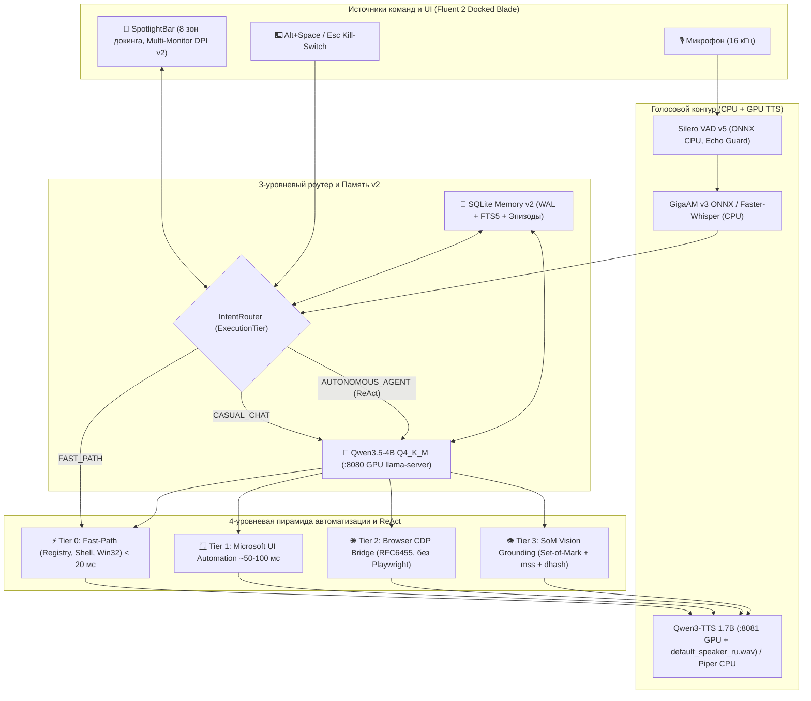

<div align="center">

# 🎖️ GupkaCommander 2.0

**Автономный локальный командный центр и ИИ-оператор ОС Windows 11**

[](#-дорожная-карта-v20)
[](https://www.microsoft.com/windows)
[](https://www.python.org/)
[](https://doc.qt.io/qtforpython-6/)
[](#-тестирование-и-сенсоры-качества-harness)
[](https://github.com/astral-sh/ruff)
[](https://mypy-lang.org/)
[](#-аппаратный-профиль-и-бюджет-памяти)
[](#-безопасность-и-аварийный-сброс-emergency-kill-switch)
[](#-матрица-уровней-исполнения-4-tier-pyramid)
[](#-быстрый-старт-установка-и-удаление)

<p align="center">
  <b>Fluent 2 Docked Blade «Губка» • 8 зон докинга и мультимониторность • 3-уровневый роутер + ReAct (CDP/UIA/SoM) • Qwen3.5-4B + Qwen3-TTS GPU + GigaAM v3 ONNX</b>
</p>

</div>

---

> [!NOTE]
> **GupkaCommander 2.0** — это персональный ИИ-оператор компьютера на базе Windows 11, работающий полностью локально.
> Фирменная выдвижная панель **Fluent 2 Docked Blade («Губка»)** с живой 9-поровой матрицей `SpongePoreWidget` крепится к любой из 8 зон экрана на мультимониторных конфигурациях, принимает голосовые и текстовые команды по **`Alt+Space`**, мгновенно исполняет системные действия через **Fast-Path** или решает сложные многошаговые задачи через автономный **ReAct-цикл (Browser CDP / Microsoft UIA / Set-of-Mark Vision)**.

---

## ✨ Ключевые возможности GupkaCommander 2.0

* **🧽 Интерфейс Fluent 2 Docked Blade «Губка»:**
  * Нативный DWM **Acrylic / Mica** backdrop, автосинхронизация **Dark / Light** тем Windows 11 с акцентом **Sponge Ochre** (`#E9B44C`).
  * **8 зон стыковки** (`top`, `bottom`, `left`, `right`, `top_left`, `top_right`, `bottom_left`, `bottom_right`) с автоматическим перемагничиванием и инверсией панели ввода внизу.
  * **Мультимониторность и Per-Monitor DPI v2:** независимая работа на 1, 2, 3+ мониторах со смешанным масштабированием (`MonitorManager` + `DockManager`).
  * Живой анимированный индикатор **«Губка»** (`SpongePoreWidget` с 9 порами 0/15/60 FPS, реагирующий на RMS-громкость микрофона), контекстные чипы (`ContextChipBar`) и компактный `AgentMiniBar` с кнопкой **`Esc · Стоп`**.
* **🧠 3-уровневый роутер + автономный ReAct-движок:**
  * `CASUAL_CHAT` — потоковый диалог с многоходовой историей, фильтрацией `<think>`-тегов и инъекцией фактов о пользователе.
  * `FAST_PATH` — детерминированное исполнение за **< 20 мс** с нулевым расходом VRAM (реестр Windows, `.lnk`, `rapidfuzz`, браузер, громкость, заметки).
  * `AUTONOMOUS_AGENT` — цикл `Observe -> Think -> Act -> Verify` (`ReActEngine`, 21 системный инструмент) с эскалацией `CDP -> UIA -> SoM Vision`, `dhash`-верификацией изменений и защитой от зацикливания.
* **🎙️ Гибридный голосовой стек 2026 (CPU + GPU под контролем `VRAMBudgetGuard`):**
  * **VAD:** `Silero VAD v5` (ONNX CPU, < 3 мс, подавление акустического эха `echo_guard` и мгновенный `Barge-In`).
  * **STT:** `GigaAM v3 E2E CTC` (INT8 ONNX CPU без PyTorch, нормализация IT-брендов) + автоматический откат на `Faster-Whisper Base INT8`.
  * **TTS:** `Qwen3-TTS 1.7B Base` (`llama-server :8081` на GPU с эталонным голосом `assets/default_speaker_ru.wav`) + автоматический откат на `Piper TTS` (ONNX CPU) при нехватке VRAM (< 6.5 ГБ) или офлайне.
* **💾 Долговременная память SQLite Memory v2 (`config/memory.db`):**
  * SQLite WAL с `FTS5` полнотекстовым поиском заметок, профилем фактов о пользователе, историей диалогов и эпизодической памятью ReAct-шагов.
* **📦 Автономный мастер установки И безопасного удаления зависимостей:**
  * Графический мастер `DependencySetupDialog` (докачка HTTP 206, Zip Slip защита, выбор GPU `llama.cpp` CUDA/Vulkan/CPU) с выборочной кнопкой **`Удалить`** на каждой карточке и **`Удалить все зависимости`**.
  * Безопасное снятие файловых блокировок перед удалением (`_release_dependency_locks` + `VoicePipeline.release_models()`), защита `_safe_remove_path` (строго внутри `models/` и `bin/`), CLI **`--remove-dependencies --yes`** и очистка моделей в деинсталляторе Windows.

---

## 🏗️ Архитектура системы v2.0



---

## ⚡ Быстрый старт, установка и удаление

### Вариант 1: Запуск из исходников (`uv` и 1-Click скрипты)
```powershell
# Установка окружения
uv sync

# Запуск приложения
uv run python main.py

# Скрипты в корне проекта
.\start.bat        # Обычный запуск
.\setup.bat        # Мастер настройки и ярлыки
.\start.ps1 -Quiet # Фоновый запуск в системный трей
```

### Вариант 2: Автономный пакет (`.exe`, портативный `.zip` и инсталлятор)
GupkaCommander 2.0 собирается в автономный Windows-пакет без зависимости от установленного Python:
```powershell
# Сборка dist/GupkaCommander/GupkaCommander.exe + портативного ZIP
uv run python scripts/build_executable.py

# Сборка инсталлятора Inno Setup (dist/GupkaCommander-Setup-v2.0.0.exe)
uv run python scripts/build_installer.py
```
* **Автономный запуск:** `dist\GupkaCommander\GupkaCommander.exe` (при первом старте предложит скачать только выбранные модели в `%LOCALAPPDATA%\GupkaCommander\models` и `bin`).
* **Портативная версия:** `dist\GupkaCommander-v2.0.0-win64-portable.zip` — распакуйте и запускайте без установки.

### Управление и удаление локальных зависимостей
* **Через GUI:** в трее выберите **`Модели и зависимости...`** -> используйте кнопку **`Удалить`** у любого компонента или **`Удалить все зависимости (~X.X ГБ)`**. Приложение автоматически остановит `llama-server.exe` и снимет блокировки с ONNX-файлов.
* **Через CLI (без GUI):**
  ```powershell
  # Интерактивное подтверждение
  GupkaCommander.exe --remove-dependencies

  # Автоматическое удаление без запроса
  uv run python main.py --remove-dependencies --yes
  ```
* **При деинсталляции приложения:** секция `[UninstallDelete]` в `scripts/installer.iss` удаляет `%LOCALAPPDATA%\GupkaCommander\models` и `bin`, сохраняя пользовательскую базу `config\memory.db` и `config\settings.json`.

> [!TIP]
> * **Вызов панели:** нажмите **`Alt+Space`** в любом окне Windows.
> * **Экстренная остановка:** нажмите **`Esc`**, кнопку **`Esc · Стоп`** на мини-баре или резко встряхните мышью (`FailSafe`).

---

## 📊 Матрица уровней исполнения (4-Tier Pyramid)

| Уровень | Технологический стек | Сценарии использования | Задержка | Расход VRAM |
| :--- | :--- | :--- | :--- | :--- |
| **Tier 0: Fast-Path** | Windows Registry, `.lnk`, `rapidfuzz`, Win32 API | Запуск программ, сайты, поиск, громкость, окна, заметки | **< 20 мс** | **0 МБ** |
| **Tier 1: Semantic UIA** | `uiautomation` (Microsoft UI Automation COM) | Клик по кнопкам и ввод текста по элементам окон Windows | **~50–100 мс** | **0 МБ** |
| **Tier 2: Browser CDP** | `BrowserCDPBridge` (HTTP + чистый RFC6455 WebSocket) | Инспекция DOM (`[index]<tag>`), клики, ввод, навигация в Chrome/Edge | **~50–100 мс** | **0 МБ** |
| **Tier 3: SoM Vision** | `mss` + `MonitorManager` + `SoMAnnotator` + `Qwen3.5-4B` | Неразмеченный GUI, игры, сложные элементы (с `dhash`-верификацией) | **~1–2 сек** | **~3.4 ГБ** |

---

## 💻 Аппаратный профиль и бюджет памяти

Оптимизировано для ноутбуков и десктопов уровня **NVIDIA RTX 5050 Laptop (8 ГБ VRAM)** / **Intel i5-14450HX** / **16 ГБ RAM**:

| Компонент | Вычислитель | Потребление памяти |
| :--- | :--- | :--- |
| **Silero VAD v5 + GigaAM v3 INT8 (ONNX)** | CPU | **0 МБ VRAM** / ~260 МБ RAM |
| **Qwen3.5-4B (Q4_K_M + mmproj F16, `:8080`)** | GPU (`llama-server`) | **~3.4–4.0 ГБ VRAM** |
| **Qwen3-TTS 1.7B (Q4_K_M + mmproj Q8_0, `:8081`)** | GPU (`VRAMBudgetGuard >= 6.5 ГБ`) | **~1.5 ГБ VRAM** (автооткат на Piper CPU при < 6.5 ГБ) |
| **PySide6 Fluent 2 Blade + SQLite WAL** | CPU / DWM | **0 МБ VRAM** / ~100 МБ RAM |

---

## 🛡️ Безопасность и аварийный сброс (Emergency Kill-Switch)

> [!IMPORTANT]
> * **Аппаратный перехватчик `Esc` и кнопка «Стоп»:** мгновенно прерывают `ReActEngine`, эмуляцию ввода и потоковый вывод.
> * **Mouse Shake Detector:** резкое движение мыши пользователем прерывает автономные действия (с защитой `suppress_mouse_shake()` при синтетических кликах).
> * **Hardening `ShellExecutor`:** блокировка `-EncodedCommand`, Base64-обфускации, backtick-инъекций и деструктивных операций ФС.
> * **Изолированное удаление моделей (`_safe_remove_path`):** каноническая проверка `is_relative_to` запрещает выход за пределы `models/` и `bin/` (включая симлинки и `..`).

---

## 📁 Организация репозитория

```text
GupkaCommander/
├── main.py                         # Главный контроллер, VoiceBridge, ReAct wiring, CLI
├── GupkaCommander.spec             # PyInstaller спецификация автономной сборки
├── pyproject.toml                  # Зависимости uv, настройки ruff, mypy strict, pytest
├── AGENTS.md / TASK.md             # Контракт разработки и живой трекер состояния
├── assets/
│   ├── gupka_commander.ico / .png  # Фирменная иконка приложения
│   └── default_speaker_ru.wav      # Стабильный эталонный голос для Qwen3-TTS
├── config/
│   ├── settings.json               # Параметры UI (докинг/тема), аудио, STT/TTS и LLM
│   ├── commands.json               # Базовые алиасы приложений и веб-сайтов
│   └── memory.db                   # SQLite WAL: факты, заметки FTS5, диалоги, эпизоды
├── core/
│   ├── paths.py                    # Виртуализация путей (_MEIPASS vs %LOCALAPPDATA%)
│   ├── bootstrap.py                # Инспекция, докачка и безопасное удаление моделей/bin
│   ├── app_finder.py               # Сканер приложений и .lnk (rapidfuzz)
│   ├── os_controller.py            # ShellExecutor, управление окнами, звуком и URL
│   ├── failsafe.py                 # Аварийный монитор (Esc / Mouse Shake)
│   ├── agent/                      # ReActEngine, ToolRegistry (21 инструмент), StepVerifier
│   ├── brain/                      # LocalLLMClient (SSE + ThinkTagFilter), LlamaServerManager
│   ├── browser/                    # BrowserCDPBridge (чистый CDP без Playwright)
│   ├── memory/                     # MemoryManager v2 и SQLite WAL/FTS5 схема
│   ├── routing/                    # 3-уровневый IntentRouter (CASUAL_CHAT/FAST_PATH/AGENT)
│   ├── uia/                        # Microsoft UI Automation (Tier 1 UIA)
│   ├── vision/                     # MonitorManager (DPI v2), ScreenCapture, SoMAnnotator, VisionAgent
│   └── voice/                      # AudioCapture, Silero VAD, GigaAM v3, Whisper, Qwen3-TTS, Piper
├── gui/
│   ├── theme_manager.py            # Fluent 2 токены (Dark/Light + Sponge Ochre), DWM Acrylic/Mica
│   ├── dock_manager.py             # 8 зон докинга и мультимониторное позиционирование
│   ├── sponge_pore_widget.py       # Живой 9-поровый индикатор «Губка» (0/15/60 FPS)
│   ├── agent_widgets.py            # ContextChipBar, StepCard, AgentMiniBar
│   ├── spotlight_bar.py            # Главная панель Docked Blade
│   ├── chat_drawer.py              # Выдвижная история чата и живых шагов ReAct
│   ├── setup_dialog.py             # Мастер загрузки и удаления зависимостей
│   ├── settings_dialog.py          # Окно системных настроек и темы
│   ├── hotkey_manager.py           # Win32 глобальный хоткей Alt+Space
│   └── tray_icon.py                # Системный трей Windows
├── scripts/
│   ├── build_executable.py         # Сборка .exe и GupkaCommander-v2.0.0-win64-portable.zip
│   ├── build_installer.py          # Сборка Inno Setup инсталлятора
│   ├── installer.iss               # Конфигурация установщика и [UninstallDelete]
│   └── download_models.py / run_llama_server.* / create_shortcut.py / generate_icon.py
└── tests/                          # Полный набор детерминированных тестов (pytest)
```

---

## 🗺️ Дорожная карта v2.0

- [x] **Фаза 1 (Мультимониторность и SoM):** `MonitorManager`, Per-Monitor DPI v2, `SoMAnnotator`.
- [x] **Фаза 2 (Память v2 и контекст):** `FTS5` заметки, эпизодическая память ReAct, многоходовый чат и `ThinkTagFilter`.
- [x] **Фаза 3 (3-уровневый роутер и ReAct):** `ExecutionTier`, `BrowserCDPBridge`, `ToolRegistry` (21 инструмент), `StepVerifier`, `ReActEngine`.
- [x] **Фаза 4 (GPU-стек 2026):** `Qwen3.5-4B`, `Qwen3-TTS 1.7B` (`:8081` + `default_speaker_ru.wav`), `GigaAM v3 ONNX`, `VRAMBudgetGuard`.
- [x] **Фаза 5 (Fluent 2 Docked Blade «Губка»):** `ThemeManager`, `DockManager` (8 зон), `SpongePoreWidget`, `ContextChipBar`, `StepCard`, `AgentMiniBar`.
- [x] **Фаза 6 (Управление зависимостями и релиз v2.0):** безопасное удаление моделей в GUI и CLI (`--remove-dependencies --yes`), `[UninstallDelete]` в инсталляторе, сборка `.exe` и портативного `.zip`.

---

## 🧪 Тестирование и сенсоры качества (Harness)

```powershell
# Запуск полного набора тестов (769 тестов)
uv run pytest -q

# Статический анализ кода (Ruff linter)
uv run ruff check .

# Проверка форматирования (Ruff formatter)
uv run ruff format --check .

# Строгая проверка типов (Mypy strict, 102 файла)
uv run mypy core gui tests scripts main.py
```

---

## 📜 Лицензия

Проект распространяется под открытой лицензией **MIT**. Разработано [Gupkagrop](https://github.com/Gupkagrop).
