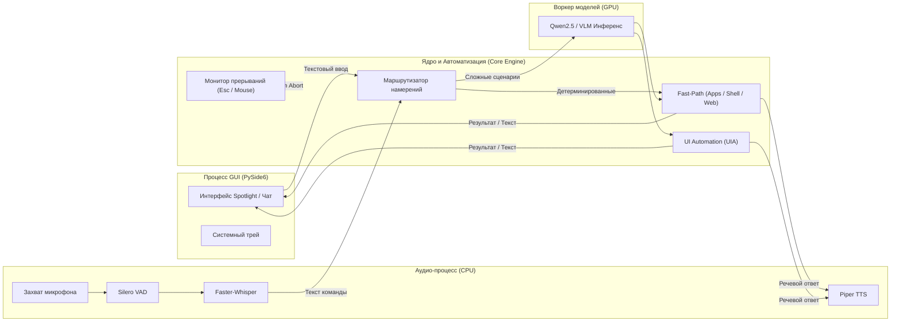

# 🏛️ Архитектура системы GupkaCommander: Системный обзор

> [!NOTE]
> **Назначение документа:** Комплексное описание системной архитектуры GupkaCommander. Включает модель межпроцессного взаимодействия (IPC), жизненный цикл событий, принципы изоляции компонентов и политику управления ресурсами под Windows 11.

---

## 1. Общие принципы проектирования

1. **Разделение контуров (Decoupled Multi-Process):**
   * Графический интерфейс (GUI) на базе Qt/PySide6 не должен блокироваться при инференсе нейросетей или аудиозаписи.
   * Голосовой поток (STT/VAD) изолирован от графического потока.
   * Тяжелые вычисления (VLM/LLM) запускаются в отдельном воркере или через локальный OpenAI-совместимый сервер (`llama.cpp` / `vLLM` / `Ollama`), что исключает конфликты библиотек CUDA/cuDNN и утечки памяти.

2. **Нулевая задержка на тривиальных командах (Zero-Latency Fast-Path):**
   * Пользователь не должен ждать секунды ответа нейросети, если команда детерминирована (например, «открой блокнот», «запусти консоль», «открой яндекс»).

3. **Гарантия безопасности и перехвата (Fail-Safe First):**
   * Управление мышью и клавиатурой может быть прервано пользователем в любую миллисекунду через аппаратный перехватчик `pynput` / Win32 Hook.

---

## 2. Диаграмма межпроцессного взаимодействия (IPC)

---

## 3. Модель событий и шина сообщений

Для взаимодействия компонентов используется асинхронная очередь сообщений или легковесный локальный протокол (IPC / Named Pipes / PySide Signals):

- `Event(type="INPUT_USER_TEXT", text=...)`: Текст от пользователя (из чата или после STT).
- `Event(type="AGENT_STATE_CHANGED", state="LISTENING" | "THINKING" | "EXECUTING" | "IDLE")`: Обновление статуса в интерфейсе.
- `Event(type="ACTION_EXECUTE", action=..., params=...)`: Запрос на выполнение действия в ОС.
- `Event(type="ACTION_ABORT", reason="USER_INTERRUPT")`: Мгновенный сигнал прерывания.
- `Event(type="AGENT_RESPONSE", text=..., speak=True)`: Вывод ответа в чат и отправка на синтез речи.

---

## 4. Профиль потребления ресурсов (Бюджет VRAM и RAM)

* **VRAM (Всего доступно 8151 МБ):**
  * ОС Windows 11 + мониторы: ~600–900 МБ.
  * Faster-Whisper (если на GPU, иначе 0 на CPU): ~350 МБ.
  * Локальная модель (Qwen2.5-3B-Instruct Q4_K_M или Qwen2.5-VL-3B Q4): ~2.2–3.5 ГБ.
  * Запас под контекст и буферы: ~2.5 ГБ.
  * **Итог:** безопасная работа без риска OOM (Out of Memory).

* **RAM (Всего 16 ГБ):**
  * ОС и фоновые службы: ~6–8 ГБ.
  * Python runtime + PySide6: ~150 МБ.
  * Silero VAD + Piper TTS (ONNX Runtime CPU): ~200 МБ.
  * Кэш приложений и дескрипторов: ~50 МБ.
  * **Итог:** запас свободной оперативной памяти > 4–6 ГБ.
