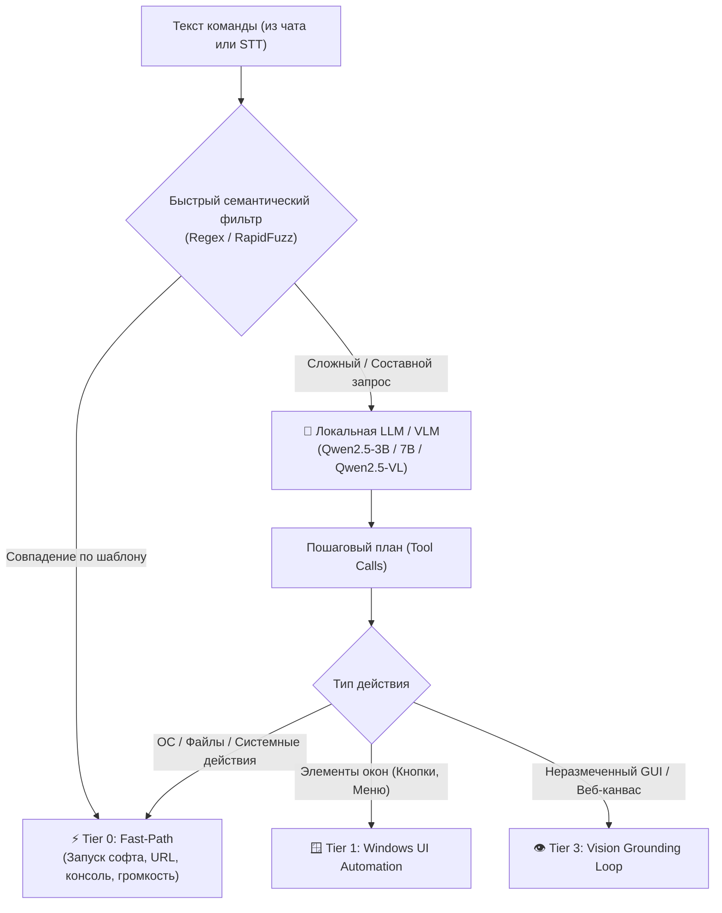

# 🧠 Интеллектуальный роутер и Vision Grounding

> [!NOTE]
> **Назначение документа:** Спецификация когнитивного ядра ассистента. Описывает двухуровневую маршрутизацию (Fast Router vs Local LLM), семантическое взаимодействие через Windows UI Automation и резервный визуальный контур (Vision Grounding).

---

## 1. Двухуровневая маршрутизация намерений

---

## 2. Локальное ядро моделей (LLM & VLM)

### Варианты конфигурации для RTX 5050 (8 ГБ VRAM):

1. **Конфигурация А: Единая мультимодальная модель (Рекомендуемая)**
   * **Модель:** `Qwen2.5-VL-3B-Instruct` (квантование Q4_K_M через `llama-cpp-python` или Ollama).
   * **Потребление VRAM:** ~2.5–3.0 ГБ.
   * **Преимущество:** Одна модель отвечает и за диалог, и за вызов системных инструментов (Tool Calling), и за анализ скриншотов с генерацией координат. Нет необходимости переключать или выгружать веса из видеопамяти.

2. **Конфигурация Б: Раздельные легковесные агенты**
   * **Модель рассуждений (LLM):** `Qwen2.5-3B-Instruct` или `Qwen2.5-7B-Instruct-Q4` (~2.0–4.2 ГБ VRAM).
   * **Модель экранного зрения (Vision Detector):** Microsoft OmniParser v2 (`icon_detect_v3` на базе YOLOv9 + Florence-2 captioner) или UI-TARS-2B.
   * **Преимущество:** Максимальная точность локализации мелких иконок в Windows 11.

---

## 3. Семантическая автоматизация (Tier 1: Windows UIA)

Вместо слепого поиска по пикселям агент сначала опрашивает дерево доступности Windows (UI Automation API):
* Библиотека: `uiautomation` (Python).
* Позволяет мгновенно находить элементы по:
  * `Name` (название кнопки или пункта меню, например "Сохранить", "Новый файл").
  * `AutomationId` (уникальный идентификатор контрола).
  * `ControlType` (`ButtonControl`, `EditControl`, `MenuItemControl`).
* **Прямые действия:**
  * Вызов `InvokePattern` (клик без физического перемещения курсора мыши).
  * `ValuePattern.SetValue()` (мгновенный ввод текста без эмуляции посимвольного набора).

---

## 4. Визуальный контур (Tier 3: Vision Grounding)

Используется только тогда, когда элемент не доступен через UIA (игры, видеоплееры, сложные холсты):

1. **Захват кадра (Screen Capture):**
   * Библиотека `mss` (захват экрана за ~10–15 мс через нативные вызовы GDI / Desktop Duplication API).
2. **Учет DPI-масштабирования:**
   * Автоматическое получение коэффициента масштабирования Windows (`GetDpiForWindow` / `ctypes.windll.shcore.GetScaleFactorForDevice`).
   * Проекция относительных координат модели (например, $[0, 1000]$) в реальные физические пиксели экрана.
3. **Безопасная эмуляция (Input Emulation):**
   * Плавное перемещение мыши для наглядности (`pyautogui.moveTo(x, y, duration=0.2)`).
   * Физический клик и верификация (повторный снимок экрана через 300 мс для проверки, изменилось ли состояние окна).
4. **Защита от зацикливания:**
   * Ограничение шагов: максимум 5 попыток для одного действия.
   * Сравнение хешей скриншотов: если экран не изменился после клика, агент признает неудачу и сообщает пользователю, а не кликает бесконечно.
