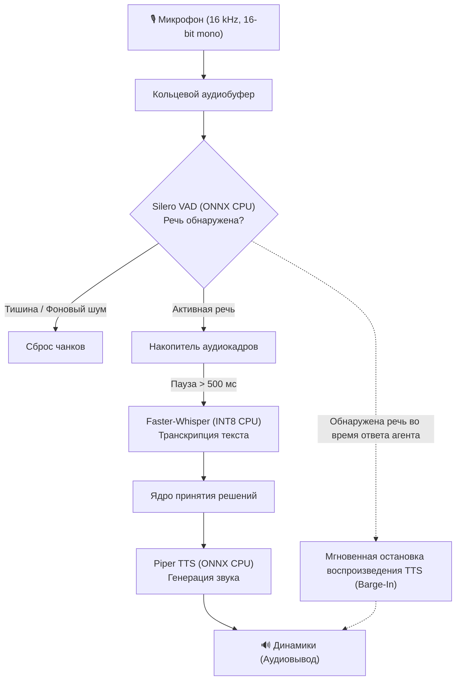

# 🎙️ Архитектура голосового контура (Voice Pipeline)

> [!NOTE]
> **Назначение документа:** Спецификация голосового контура LocalAgent. Описывает архитектуру захвата звука, детекции активности речи (VAD), распознавания (STT), генерации речи (TTS), механизма перебивания (Barge-In) и изоляции нагрузки на CPU.

---

## 1. Ключевые требования к голосовому контуру

1. **Минимальная латентность:** Время от окончания фразы пользователя до начала исполнения команды — не более **300–500 мс**.
2. **Нулевой расход VRAM:** Все компоненты контура (VAD, STT, TTS) функционируют на **CPU** (через ONNX Runtime и CTranslate2 INT8).
3. **Естественное звучание:** Поддержка интонационно выразительного синтеза русской речи без роботизированного скрежета.
4. **Barge-In (Прерывание на лету):** Если агент говорит, а пользователь начинает говорить («стой», «отмена»), синтез речи немедленно затихает (Audio Ducking / Cancel).

---

## 2. Диаграмма аудиопотока

---

## 3. Стек компонентов

### 3.1. Детекция речи: Silero VAD
* **Формат:** ONNX модель на базе легкой рекуррентной сети.
* **Латентность:** < 5 мс на чанк в 30 мс (512 сэмплов при 16 кГц).
* **Назначение:** Отсекает фоновые шумы клавиатуры, кулеров и музыки, запускает запись только при реальной человеческой речи и детектирует окончание реплики при паузе 400–600 мс.

### 3.2. Распознавание речи (STT): Faster-Whisper
* **Движок:** `CTranslate2` (быстрый C++ движок с INT8 квантованием).
* **Модель:** `whisper-small` или `whisper-base`.
* **Параметры:**
  * `language="ru"`
  * `beam_size=1` (жадный поиск для сокращения задержки в 3 раза при сохранении 98% точности)
  * `vad_filter=False` (так как предварительная фильтрация уже выполнена Silero VAD).
* **Время инференса:** ~150–250 мс на реплику длиной 2–4 секунды на процессоре Intel i5-14450HX.

### 3.3. Синтез речи (TTS): Piper TTS
* **Движок:** `piper-phonemize` + `onnxruntime` на CPU.
* **Голосовые модели для русского языка:**
  * `ru_RU-dmitri-medium` (мужской, энергичный и четкий тембр).
  * `ru_RU-ruslan-medium` (мужской, глубокий тембр).
  * `ru_RU-irina-medium` (женский тембр).
* **Производительность:** Real-time factor (RTF) $\approx 0.05$ (1 секунда речи генерируется за 50 миллисекунд).
* **Воспроизведение:** Потоковое через `sounddevice` или `pygame.mixer` с возможностью мгновенного сброса буфера (`stop()`).

---

## 4. Режимы активации

1. **Push-to-Talk (Рекомендуемый для точности):**
   * Удержание или переключение глобальной горячей клавиши (например, `Caps Lock` или `Alt + Space`).
   * Полностью исключает случайные срабатывания при разговорах в комнате.
2. **Wake-Word (Голосовая активация):**
   * Модуль `openWakeWord` на CPU (фраза: «Привет, Агент» / «Джарвис»).
3. **Автоматический VAD-режим (Свободный диалог):**
   * Микрофон всегда слушает при открытом окне ассистента; при закрытии — переходит в режим ожидания.
